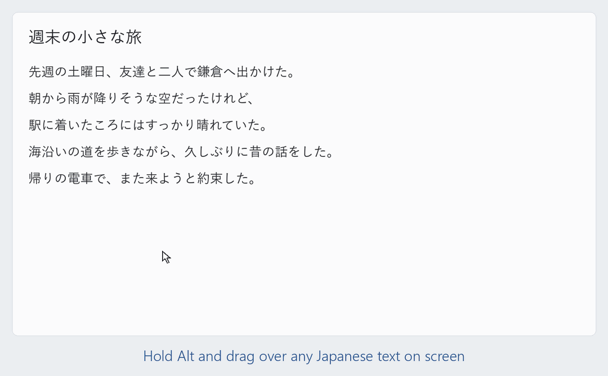
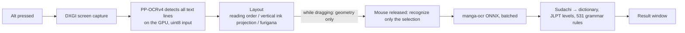
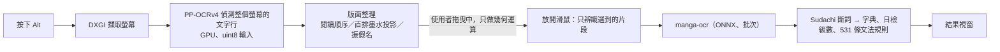

# jplens — look up Japanese anywhere on your screen

**English** · [繁體中文](#zh-tw)



On Windows, **hold Alt and drag** over any Japanese text on screen — games, paused anime, manga, novels, web pages, horizontal or vertical —
and jplens instantly lists the words you selected with their reading, JLPT level, part of speech and meaning, followed by the
**grammar patterns** in the sentence (e.g. 〜と思う, 〜かもしれない).
Save words, grammar and sentences to your vocabulary book with one click, then search, filter, star, **quiz yourself**, **listen to them**,
and export them to a flashcard app.

- Lookups run entirely on your own PC (text recognition by [manga-ocr](https://github.com/kha-white/manga-ocr), word segmentation by Sudachi):
  no internet connection or API needed. Full-sentence translation and sentence explanations are optional extras that use a
  Gemini API key (the free tier is enough) or any OpenAI-compatible service.
- With an NVIDIA GPU, results appear about 0.1–0.5 s after you release the mouse; AMD/Intel GPUs are accelerated by the DirectML build;
  it also works without a GPU (CPU, much slower).
- Vertical novels, furigana and manga speech bubbles get special handling.
- Meanings and the interface are available in **English** or **Traditional Chinese** (by default it follows your Windows display language).

## Download

See the latest version on the [Releases](../../releases) page; the zip files are in the Google Drive folder linked from the release
(they are too large for GitHub). Unzip and double-click `jplens.exe` — no Python needed, but keep the whole `jplens` folder.
When the red 「字」 icon appears in the system tray and the "Ready" notification pops up, you're good to go.

| Your situation | Download |
| --- | --- |
| Already using the previous version | The **update package** (e.g. `jplens-v0.4.0-update-from-v0.3.0.zip`), only for the old version named in the file |
| First install, NVIDIA GPU | **CUDA build** `jplens-vX-win64-cuda.zip` (about 2.5 GB), fastest |
| First install, AMD/Intel GPU, no dedicated GPU, or you want something smaller | **DirectML build** `jplens-vX-win64-directml.zip` (about 1.1 GB) |

- The DirectML build accelerates on any DirectX 12 GPU. On the same RTX 4060 laptop it recognizes about 2× slower than the CUDA build — still under
  half a second per lookup, with identical results. If the GPU turns out slower than the CPU (e.g. older integrated graphics) it switches to the CPU.
  Settings → Advanced shows what is in use; Settings → About shows the version.
- **Updating**: quit jplens from the tray → unzip the update package or the new full build into **the folder that contains `jplens`**, replacing files →
  start `jplens.exe` as usual. Your settings, vocabulary and translation cache (`config.json`, `vocab\`, `cache\`, `captures\`) are not in the zip and
  won't be overwritten; the Gemini API key is stored in Windows Credential Manager.
  When switching between the CUDA and DirectML builds, unzip into a new folder and copy those files and folders over.
- Windows 10/11, 64-bit. Windows SmartScreen may warn on first launch (the executable is not signed): click "More info" → "Run anyway".

## How to use

Three selection modes (switch with Alt + right-click, the buttons on the result window's title bar, or the tray menu):
- **Text**: drag along the text from the first character to the last, like selecting text in a word processor. Works across lines and in vertical text.
- **Box**: drag a rectangle; everything inside is looked up.
- **Manga**: a manga-specific model finds the text inside speech bubbles and reads each bubble as a whole, so no column is missed.
  Hold Alt and **draw a box around the bubble**, or hold Alt and **double-click the bubble**. Meant for manga only — use the other two modes
  for subtitles, novels and games.

| Action | What it does |
| --- | --- |
| Hold Alt + left-drag | Select the text to look up; recognition starts when you release |
| Hold Alt + right-click | Switch selection mode (Text → Box → Manga) |
| Level menu on the result window | Only show words at this JLPT level or above (words outside the JLPT lists are always shown) |
| Hover over a word | Full meanings and the sentence it came from; for grammar: explanation, formation and an example |
| ＋ Save / ＋ Save sentence | Save to the vocabulary book; select part of the recognized text first to save only that part |
| Translate | Translate the whole sentence (optional, needs an API key — see below) |
| 📌 | Pin: the window stays open when you click elsewhere or press Esc (close it with ✕) |
| Esc, ✕, click elsewhere | Close the result window (when pinned, only ✕ closes it) |

**Listen mode** (live streams, anime without subtitles): press **Alt + L** (the letter can be changed in Settings) to transcribe the audio your PC is
playing in real time. A separate window lists the sentences as they are heard — grey provisional text while someone is speaking, replaced by the
final result when they finish. Click any sentence to put it in the text box below and press "🔍 Look up" to look up its words.
If you watch at a higher playback speed, choose the same speed in the window's menu (the audio is slowed back down before recognition).
If a sentence is missed or split wrongly, "💾 Save audio" keeps the last 2 minutes of speech so it can be used to improve the tool.
Speech recognition runs on the CPU only (about 5–15 % of one core). It records everything your PC plays, including notification sounds.

**Tray menu** (the 「字」 icon; it may be hidden under "^" at the bottom-right of the taskbar):
- **Vocabulary**: words, grammar and sentences in separate tabs; search, filter (level, part of speech, date saved, learned, starred) and sort;
  star **important words**, mark words as **learned**, edit and delete (with undo). Thousands of words open instantly (3,000 words in about 0.1 s).
  - **Vocabulary quiz** ("Practice → Vocabulary quiz" on the left): pick the meaning of a word, pick the word for a meaning, or both; quiz only starred words,
    recent words or certain levels. Exactly one of the four options is correct (synonymous meanings never appear together), and the wrong
    options are chosen so you can't simply guess from the kanji. If your answer was also right, press "This is also right";
    at the end you can retake the ones you missed.
  - **Listen**: on an expanded word card there is a speaker next to the reading and another next to the sentence. It reads the reading you saved
    (辛い saved as からい is not read as つらい), using the Japanese voice built into Windows. If you don't have one, add "日本語" under
    Settings → Time & language → Speech → Add voices (free, offline); no restart needed.
  - **Import** (flashcard-app backups, full backups), **full backup**, **clear** (with undo), **add a word manually**.
- **Export**: words → flashcard-app backup file (starred words stay starred); sentences → a numbered text file. You can choose what to export.
- **Settings**: hotkey (Alt / Ctrl+Shift / Ctrl+Alt), default selection mode, result-window font size and width, vocabulary folder, start automatically at login,
  languages, translation service, and more. Most changes apply immediately.
- **Save the last lookup's screenshot**: when something is misread, save the screen and type the correct text so it becomes test data.

**Nothing happens in a game?** Many games (e.g. Zenless Zone Zero, Wuthering Waves) run as administrator, and Windows doesn't let normal programs
receive keys pressed over them. Choose "Restart as administrator" in the tray menu, or turn on "Run as administrator" in Settings → General.
Use windowed or borderless mode in the game.

### Languages

Settings → General has two separate settings:
- **Explanation language** (English / 繁體中文): word meanings, grammar notes, sentence translations and explanations.
  In English, word meanings come from JMdict and grammar notes from an English edition of all 706 grammar entries. Applies to new lookups.
- **Interface language** (English / 繁體中文): menus, buttons and messages. Restart jplens (quit from the tray and open it again) to apply.

On first launch both follow your Windows display language: Chinese → 繁體中文, anything else → English.

### Sentence translation (optional)

The **Translate** button and the sentence **explanations** in the vocabulary book use Gemini (`gemini-3.5-flash-lite` for translation; the
explanation model can be chosen). Paste a free [Gemini API key](https://aistudio.google.com/apikey) in Settings → Translation & AI.
You can also use any OpenAI-compatible service instead (Groq, OpenRouter, DeepSeek, OpenAI, or a local Ollama / LM Studio).
Translations can be done only when you press the button, prepared in the background, or shown automatically. Word lookups never need this.

## Technical highlights

> Test machine: Windows 11, RTX 4060 Laptop (8 GB), 2560×1440 display.



**Low latency — 0.1–0.5 s from release to result.**
- The whole screen is captured and text lines are detected in the background as soon as Alt goes down; dragging only does geometry,
  and only the selected part is recognized after release.
- DXGI capture takes 2–3 ms. The detection model takes uint8 input directly, with casting and normalization done on the GPU (a quarter of the upload).
- manga-ocr runs on ONNX Runtime with a hand-written KV-cache decoder; IOBinding keeps the cache on the GPU, and the pieces of one lookup are batched.
- Mouse-move events are coalesced and ink profiles cached, so each update while dragging takes 0.6–2 ms.

**Low memory — about 0.87 GB resident (was 1.58 GB), about 2 s to start (was 11 s).**
- No PyTorch at runtime: manga-ocr is exported to ONNX with a rewritten beam search whose output matches the original character for character.
- CUDA/cuDNN libraries are located and loaded directly (bundled in the CUDA build) instead of through torch.
- Lazy loading: the manga model loads when you switch to manga mode; the vocabulary and settings windows are created when opened and freed when closed.
- Native PySide6 widgets, no embedded browser.

**Recognition accuracy.**
- Vertical novels: columns and furigana are found by vertical ink projection and character cells are estimated, so selections snap to character
  boundaries. Fully correct box selections went from **126 → 199** (227 boxes), random text selections from **45 → 118** (119 drags).
- Manga: a speech-bubble detector (RT-DETR) lets each bubble be read as a whole.
- Furigana are used as reading hints, and they also merge character names that the segmenter split apart.
- Long lines are cut into overlapping chunks (about two characters of overlap) and joined by matching heads and tails.
- Small text is re-detected at a larger scale; detection uses two thresholds (0.5 as the main pass, 0.3 to recover missed lines).
- manga-ocr's beam-search candidates are re-scored with Sudachi's segmentation cost (how much a reading looks like real Japanese),
  so a valid word beats a look-alike misread (受話器, not 愛話器). Character error rate on 4,500 held-out synthetic lines: 0.51 % → 0.43 %.

**Language analysis.**
- Idioms are looked up as a whole (2–6 consecutive words, so 気になる isn't split into 気 + なる), including conjugated and negative forms.
- Dictionary entries are chosen by spelling, reading and part of speech; rare senses go last; other common readings of the same spelling are listed.
- 531 grammar rules — 303 of them generated by an LLM and then automatically verified (every positive example must match, no negative example may
  match, corpus hit rate must stay low, no existing rule may be shadowed) and spot-checked by hand.
- Quiz answers are unique: besides string matching, a semantic model (bge-small-zh, int8, 24 MB, CPU) rejects options whose meanings are too similar.

**Evaluation.**
- In-house tools: `box_eval` (re-runs saved real screens with correct answers), `select_eval` (simulates drags on full screenshots and diffs the
  output before and after a change), synthetic-sample OCR (99.6 % character accuracy, reproducible from the repo).
- The "Save the last lookup's screenshot" menu item turns any misreading into a new test case in one step.
- Accuracy figures are measured on the author's own real screenshots (games, anime, novels, manga; about 120 images), which are copyrighted
  and therefore not included.

**Windows integration.**
- Win32 low-level mouse/keyboard hooks and per-monitor DPI coordinate mapping.
- Detects games running as administrator and offers a one-click restart as administrator.
- Picks the acceleration automatically: CUDA → DirectML (only if measurably faster than the CPU; the high-performance GPU on multi-GPU laptops) → CPU.
- PyInstaller builds (CUDA and DirectML) with a `--selftest`; update packages contain only changed files (v0.3.0 → v0.4.0 is 43 MB).
- Text-to-speech through the voices built into Windows (Qt TextToSpeech: WinRT, falling back to SAPI).

## Companion flashcard app: CharlieLearningV

Words saved in jplens can be exported to **CharlieLearningV** (a flashcard app by the same author; its interface is currently in Traditional Chinese)
for review on your phone: search, stars, timed quizzes (meaning or word, by JLPT level).

- **Web**: <https://charlie-learning-v.netlify.app/> (no install; data lives in your browser — export a backup regularly from the "備份" page)
- **Android**: `CharlieLearningV.apk` on the [Releases](../../releases) page (allow installing apps from unknown sources)

To move words over: jplens tray → Export → Words (flashcard-app backup) and save the `.txt` → copy it to your phone →
CharlieLearningV menu → 「備份」 → 「📥 匯入資料」 and pick the file. Readings, example sentences, JLPT levels and stars come along;
importing the same word again never duplicates it or overwrites what you edited in the app.

## Running from source

Windows, Python 3.10.

```bash
pip install -r requirements.txt
```

Models and the dictionary are not in the repo (too large); prepare them first:

1. **Dictionary** `data/dict.sqlite`: put these files in `data/raw/`, then run `python tools/build_dict.py` (1–2 minutes).
   - `JMdict_e.gz`: <http://ftp.edrdg.org/pub/Nihongo/JMdict_e.gz>
   - `zhwikt_ja.jsonl`: Japanese entries of the Chinese Wiktionary, <https://kaikki.org/zhwiktionary/日語/> (JSONL)
   - `tomoshi/tomoshi-dict-open.db`: the `.db.zst` from [Tomoshi open data](https://github.com/tomoshi-app/tomoshi-dict-data/releases), unpacked with
     `zstd -d` (optional; without it far fewer words have Chinese meanings)
2. **Text recognition model**: `python tools/export_manga_ocr_onnx.py` exports manga-ocr to ONNX in `data/models/manga-ocr-onnx/` (about 460 MB).
   Only the export needs `pip install torch transformers manga-ocr`; running jplens does not.
3. **Manga mode model** (only for manga mode): `detector.onnx` (NVIDIA) or `detector_int8.onnx` (CPU) from
   [ogkalu/comic-text-and-bubble-detector](https://huggingface.co/ogkalu/comic-text-and-bubble-detector/tree/main), plus `config.json` and
   `preprocessor_config.json`, in `data/models/ogkalu/`.
4. **Listen mode models** (only for listen mode), in `data/models/asr/`:
   - [sherpa-onnx-zipformer-ja-reazonspeech-2024-08-01](https://github.com/k2-fsa/sherpa-onnx/releases/tag/asr-models) (`.tar.bz2`, unpacked into a
     folder of the same name; only `*.int8.onnx` and `tokens.txt` are used)
   - [silero_vad.onnx](https://github.com/k2-fsa/sherpa-onnx/releases/tag/asr-models) (Silero v4, used to recover missed speech)
   - `silero_vad_v6.onnx`: `silero_vad.onnx` from [snakers4/silero-vad v6.2.3](https://github.com/snakers4/silero-vad/tree/v6.2.3/src/silero_vad/data),
     renamed (the main voice activity detector)
5. (Optional, faster) a uint8-input detection model: `pip install onnx`, then `python tools/export_det_onnx.py`. Otherwise RapidOCR's model is used.

With an NVIDIA GPU, CUDA 12 + cuDNN 9 libraries must be findable: in `data/cuda/`, from pip's `nvidia-*` packages, or borrowed from a cu12 PyTorch
install (`jplens/gpu.py`); otherwise the CPU is used. For AMD/Intel GPUs replace `onnxruntime-gpu` with `onnxruntime-directml` (they can't be installed
in the same environment; use a separate virtual environment).

Start it by double-clicking `run_realtime_words_translate.bat` (no console window), or to see the log output:

```bash
python -m jplens
```

### Building the executable

```bash
pip install pyinstaller
python packaging/build.py             # CUDA build, bundles CUDA/cuDNN (about 3.8 GB) → dist/jplens/
python packaging/build.py --no-cuda   # without CUDA (CPU only on machines without it)
python packaging/build.py --directml  # DirectML build (about 1.6 GB) → dist/directml/jplens/; run it in an environment with onnxruntime-directml
```

The output folder is the distributable; the build runs `jplens.exe --selftest` to check that the models and dictionary were bundled.
`--zip` then packs `dist/jplens-vX-win64-cuda.zip` (or `-directml.zip`) plus a `.sha256`; the version number is in `jplens/__init__.py`.

```bash
python packaging/make_update.py dist/jplens-vOLD-win64.zip dist/jplens   # update package: only new and changed files
python packaging/update_install.py C:\jplens                            # update your own install from the new dist/jplens
```

## Files

| Location | Contents |
| --- | --- |
| `vocab/saved_words.jsonl` | Vocabulary: one word per line with reading, level, meanings, sentence, date saved, star, learned |
| `vocab/saved_sentences.jsonl` | Saved sentences |
| `config.json` | Settings (written by the settings window) |
| `logs/jplens.log` | Log (timing of each lookup, errors) |
| `jplens/` | Source (`app.py` main, `layout.py`/`inkcols.py` layout, `recognize.py` recognition, `words.py` words and grammar, `manager.py` vocabulary book, `quiz.py`/`quiz_ui.py` quiz, `speech.py` text-to-speech, `gpu.py` acceleration, `settings_ui.py` settings, `listen.py`/`listen_ui.py` listen mode, `i18n.py`/`lang.py` languages) |
| `tools/` | Dictionary building, model export, batch tools for grammar rules and translations, evaluation tools |
| `tests/` | `python -c "import tests.test_core as m; [getattr(m,k)() for k in dir(m) if k.startswith('test_')]"` (needs the dictionary); `tests/eval/` measures recognition accuracy (needs your own screenshots) |

In the packaged build, `config.json`, `vocab/` and `logs/` sit next to `jplens.exe`.

## Where the meanings come from

- English: [JMdict](https://www.edrdg.org/jmdict/j_jmdict.html). Grammar notes: an English edition of the 706 grammar entries, translated by Gemini
  from the Chinese notes and checked automatically (`jplens/jlearn/grammar_en.json`).
- Traditional Chinese, in order: Gemini translations of JMdict senses for words on the JLPT lists (`dict_translate/zh.jsonl`) → Tomoshi open data →
  Chinese Wiktionary; JMdict English (marked 〔英〕) when none of these has the word.
- Grammar rules: 531 in total — 228 from the original project, the other 303 written by Gemini from a JLPT pattern list, verified automatically and
  spot-checked by hand.

## License and credits

The code is licensed under the Apache License 2.0 ([LICENSE](LICENSE)). Dictionary data is licensed differently (mostly CC BY-SA 4.0); see
[NOTICE.md](NOTICE.md) for the full list.

- English meanings, parts of speech: [JMdict](https://www.edrdg.org/jmdict/j_jmdict.html) (EDRDG, CC BY-SA 4.0)
- Chinese meanings: [Tomoshi open data](https://github.com/tomoshi-app/tomoshi-dict-data) (Tomoshi (Y1Z), CC BY-SA 4.0),
  [Chinese Wiktionary](https://zh.wiktionary.org/) (CC BY-SA, extracted via [kaikki.org](https://kaikki.org/zhwiktionary/)), Gemini translations
  (from JMdict, CC BY-SA 4.0)
- JLPT word lists (`data/jlpt/`): Jonathan Waller's JLPT lists (CC BY), via open-anki-jlpt-decks (MIT)
- Text recognition: [manga-ocr](https://github.com/kha-white/manga-ocr) (Apache-2.0); text detection: PP-OCR / [RapidOCR](https://github.com/RapidAI/RapidOCR) (Apache-2.0)
- Manga mode: [ogkalu/comic-text-and-bubble-detector](https://huggingface.co/ogkalu/comic-text-and-bubble-detector) (Apache-2.0)
- Segmentation: [SudachiPy](https://github.com/WorksApplications/sudachi.rs), SudachiDict (Apache-2.0); UI: Qt / PySide6 (LGPL-3.0)

---

<a id="zh-tw"></a>

# 日文即時螢幕查字工具（jplens）

[English](#jplens--look-up-japanese-anywhere-on-your-screen) · **繁體中文**


在 Windows 上**按住 Alt、用滑鼠拖曳**選取畫面上的日文（遊戲、動畫暫停畫面、漫畫、小說，橫排直排都可以），
馬上列出選到的單字：讀音、日檢級數、詞性、意思（繁體中文或英文），下面再列出句子裡的**文法句型**（例如「〜と思う」「〜かもしれない」）。
想記的字、文法、句子按「＋ 記錄」存進單字本，可以搜尋、篩選、標重點、**做單字測驗**、**朗讀**，再匯出到單字 App。

- 查字全部在自己的電腦上跑（文字辨識用 [manga-ocr](https://github.com/kha-white/manga-ocr)、斷詞用 Sudachi），不用網路、不用 API。
  整句翻譯、句子講解是選用功能，要 Gemini API Key（免費方案就夠）或任何 OpenAI 相容的服務。
- 有 NVIDIA 顯示卡時放開滑鼠到出結果約 0.1～0.5 秒；AMD、Intel 顯示卡用 DirectML 版加速；沒有顯示卡也能用（CPU，慢很多）。
- 直排小說、振假名、漫畫對話框都有特別處理。
- 意思和介面可以選**繁體中文**或**英文**（預設跟著 Windows 的顯示語言）。

## 下載就能用的版本

到 [Releases](../../releases) 看最新版的說明，壓縮檔放在 Release 裡連結的 Google Drive 資料夾（GitHub 放不下）。
解壓縮後雙擊 `jplens.exe`（不用裝 Python；整個 `jplens` 資料夾都要留著）。右下角系統匣出現紅色「字」圖示、跳出「就緒」通知就可以用了。

| 你的情況 | 下載 |
| --- | --- |
| 已經在用上一版 | **更新包**（例如 `jplens-v0.4.0-update-from-v0.3.0.zip`，43 MB），只適用檔名寫的那個舊版 |
| 第一次安裝，有 NVIDIA 顯示卡 | **CUDA 版** `jplens-v版本-win64-cuda.zip`（約 2.5 GB），最快 |
| 第一次安裝，AMD／Intel 顯示卡、沒有獨立顯示卡，或想要小一點的 | **DirectML 版** `jplens-v版本-win64-directml.zip`（約 1.1 GB） |

- DirectML 版任何支援 DirectX 12 的顯示卡都能加速。同一張 RTX 4060 筆電上辨識約比 CUDA 版慢 2 倍，查一次字還是在半秒內，結果相同；
  顯示卡比 CPU 還慢時（例如較舊的內顯）自動改用 CPU。設定 → 進階 看得到目前用哪個，設定 → 關於 顯示版本。
- **更新**：從系統匣「結束」查字工具 → 把更新包或新版完整版解壓到**放 `jplens` 資料夾的那一層**，同名檔案選「取代」→ 照常開 `jplens.exe`。
  設定、單字本、翻譯快取（`config.json`、`vocab\`、`cache\`、`captures\`）不在壓縮檔裡，不會被蓋掉；Gemini API Key 存在 Windows 認證管理員，不用重貼。
  CUDA 版和 DirectML 版互換時請解壓到新資料夾，再把上面那幾個檔案、資料夾複製過去（有開「開機自動啟動」的話到設定裡關掉再打開一次）。
- Windows 10／11 64 位元。第一次開啟時 Windows SmartScreen 可能會警告（執行檔沒有簽章），按「其他資訊」→「仍要執行」。

## 怎麼用

三種選取方式（按住 Alt＋按一下右鍵、結果視窗標題列的按鈕，或系統匣選單切換）：
- **反白**：像在文書軟體裡選字，沿著文字從第一個字拖到最後一個字，只選你要的那句，跨行、直排都可以。
- **框選**：拖曳出一個矩形，查矩形裡所有的文字。
- **漫畫**：用漫畫專用的模型找出對話框裡的字，整塊讀，不會漏欄。按住 Alt **框住對話框**，或按住 Alt **雙擊對話框**。
  只適合漫畫，字幕、小說、遊戲請用另外兩種。

| 動作 | 說明 |
| --- | --- |
| 按住 Alt＋左鍵拖曳 | 選取要查的文字，放開就開始辨識 |
| 按住 Alt＋按一下右鍵 | 切換選取方式（反白 → 框選 → 漫畫） |
| 結果視窗的級數選單 | 只顯示這個級數以上的單字（級外的字一律顯示） |
| 滑鼠停在單字上 | 完整的中英文意思、出現的句子；文法顯示說明、接續、例句 |
| ＋ 記錄／＋ 記錄原句 | 存進單字本；先反白原文的一部分，就只記錄那一段 |
| 翻譯 | 翻譯整句（選用，要 API Key，見下面） |
| 📌 | 釘選：點畫面其他地方、按 Esc 時不自動關閉（要按 ✕） |
| Esc、✕、點別的地方 | 關閉結果視窗（釘選時只有 ✕ 能關） |

**無字幕模式**（直播、沒有字幕的動畫）：按 **Alt＋L**（設定 → 查字操作可以換字母）開始，把電腦正在播的聲音即時轉成文字。
另外開一個無字幕視窗（這段時間不能框選、反白）：聽到的句子一句一句往下排，講話中先顯示灰色的暫定文字、講完換成最終結果；下面的原文框跟著正在講的那句。
點任何一句放到下面的原文框，按「🔍 查詢」才查字；往上捲看舊句子時不會被新句子打斷，按「↓ 回到最新」再跟上。
查完字可以按「▾ 收起查詢結果」把單字清單收起來。漏句、切錯時按「💾 保存聲音」存下最近 2 分鐘有聲音的部分（影片停著的時間不算），可以拿來改進。再按一次 Alt＋L 或 ✕ 結束。
開倍速看影片時，在視窗右上的播放速度選單選一樣的倍數（辨識前先放慢回原速，1.5 倍也準）。講話中按「查詢」「翻譯」會等那句講完再做；譯文留在清單那一句的下面，下一句進來也不會消失。
語音辨識只用 CPU（約單核的 5～15%）、不佔顯示卡。錄的是整台電腦的聲音（通知音、別的分頁也會錄進去）。

**系統匣選單**（「字」圖示，左鍵或右鍵；可能被收在工作列右下角的「^」裡）：
- **單字本**：單字／文法／句子分開看；搜尋、篩選（級數、詞性、記錄時間、已學會、重點單字）、排序；
  星號標**重點單字**、標記**已學會**、編輯、刪除（可以復原）。上千個字也不卡（3,000 個字打開約 0.1 秒）。
  - **單字測驗**（左側「練習 → 單字測驗」）：看單字選意思、看意思選單字或混合；可以只考重點單字、最近記的、某些級數。
    四個選項只有一個對（同義的意思不會同時出現），錯的選項挑「看漢字猜不到」的；答錯可以按「這個也對」，結束後可以重測答錯的。
  - **朗讀**：展開的單字卡片，讀音旁、「原句」旁各有一個喇叭，唸卡片上記錄的讀音（「辛い（からい）」不會唸成つらい）。
    用 Windows 內建的日文語音：沒有的話到「設定 → 時間與語言 → 語音 → 新增語音」加入「日本語」（免費、不連網），裝好不用重開。
  - **匯入**（單字 App 的備份、完整備份）、**完整備份**、**清空**（可以復原）、**手動新增單字**。
- **匯出**：單字 → 單字 App 備份檔（重點單字會標成 App 的重點）；句子 → 編號的文字檔。匯出前可以選範圍。
- **設定**：熱鍵（Alt／Ctrl＋Shift／Ctrl＋Alt）、預設選取方式、結果視窗的字級與寬度、單字本資料夾、開機自動啟動等，改了馬上生效。
- **保存上一次查詢的畫面**：讀錯時存下來並填正確答案，當測試資料。

### 語言

設定 → 一般 有兩個分開的設定：
- **解釋的語言**（繁體中文／English）：單字意思、文法說明、整句翻譯、講解。English 時單字意思用 JMdict 的英文，文法說明用 706 條的英文版。新查的字就換。
- **介面語言**（繁體中文／English）：選單、按鈕、訊息。改了要從系統匣結束、再重新開啟才會換。

第一次啟動時兩個都跟著 Windows 的顯示語言：中文 → 繁體中文，其他 → 英文。

### 整句翻譯（選用）

結果視窗的「翻譯」和單字本句子頁的「講解」用 Gemini（翻譯用 `gemini-3.5-flash-lite`，講解的模型可選）。
到設定 → 翻譯與 AI 貼上 [Gemini API Key](https://aistudio.google.com/apikey)（免費）；也可以改用任何 OpenAI 相容的服務
（Groq、OpenRouter、DeepSeek、OpenAI，或本機的 Ollama、LM Studio）。可以選按了才翻、背景先翻好、或自動顯示。查字本身完全不需要。

**遊戲裡沒反應？** 很多遊戲（例如絕區零、鳴潮）以系統管理員身分執行，Windows 不讓一般權限的程式收到在遊戲視窗上的按鍵。
從系統匣選「以系統管理員身分重新啟動」，或在設定 → 一般打開「以系統管理員身分執行」。遊戲請用視窗模式或無邊框視窗。

## 技術特點

> 測試環境：Windows 11、RTX 4060 Laptop（8 GB）、2560×1440 螢幕。

### 處理流程



### 1. 低延遲

放開滑鼠到出結果約 **0.1～0.5 秒**。

- **預先偵測**：按下 Alt 就在背景擷取並偵測整個螢幕，拖曳時只做幾何運算，放開後只辨識選到的片段。
- **DXGI 擷取**：每次擷取 2～3 ms。
- **前處理放進模型**：偵測模型改成直接吃 uint8，轉型、正規化在 GPU 上做，上傳的資料只剩四分之一。
- **辨識推論**：manga-ocr 跑在 ONNX Runtime 上，自己實作 KV cache 解碼器，用 IOBinding 讓快取留在 GPU；同一次查詢的片段批次辨識。
- **拖曳流暢**：滑鼠移動事件合併、墨水分布快取，拖曳時每次更新 0.6～2 ms。

### 2. 低記憶體

常駐記憶體約 **0.87 GB**（原本 1.58 GB），啟動約 **2 秒**（原本 11 秒）。

- **執行時不載入 PyTorch**：manga-ocr 匯出成 ONNX，自己重寫 beam search，辨識結果和原版逐字相同。
- **不靠 torch 啟用 CUDA**：自己尋找並載入 CUDA／cuDNN 程式庫，打包版直接附帶。
- **用到才載入**：漫畫模型切到漫畫模式才載入；單字本、設定視窗開啟時才建立，關掉就釋放。
- **原生介面**：PySide6 原生元件，不用內嵌瀏覽器。

### 3. 辨識準確度

- **直排小說用墨水投影找欄**：以垂直投影找出欄與振假名，再估出字格，讓選取範圍對齊字的邊界。
  框選範圍完全正確 **126 → 199**（227 個框），隨機反白 **45 → 118**（119 次）。
- **漫畫用對話框偵測模型**（RT-DETR）：整個對話框一起讀，不會漏欄。
- **振假名當讀音提示**：修正讀音，並把被斷詞拆碎的人名合成專有名詞。
- **長行重疊切段**：相鄰兩段重疊約兩個字寬，再用頭尾比對接合，避免切在字中間。
- **小字放大重新偵測**、**雙門檻偵測**（0.5 為主、0.3 補漏）。
- **用斷詞挑辨識候選**：manga-ocr beam search 的幾個候選再加上 Sudachi 的斷詞成本（像不像正常的日文）重新評分，形近字讀錯（愛話器 → 受話器）會改回來；沒拿來調參的 4,500 行合成文字圖，字錯誤率 0.51% → 0.43%。

### 4. 語言分析

- **慣用說法整組查**：連續 2～6 個詞合起來查字典（「気になる」不會拆成「気」＋「なる」），處理活用與否定。
- **讀音與詞義挑選**：依寫法、讀音、詞性挑字典條目；冷僻的意思排到後面；列出同寫法的其他常用讀音。
- **531 條文法規則**：其中 303 條由 LLM 產生，經過自動驗證（正例都要比對到、反例都不能比對到、語料命中率不能過高、不能蓋掉現有規則）與人工抽查。
- **單字測驗的答案唯一**：中文意思除了字串比對，再用 bge-small-zh（int8、24 MB、CPU）算語意相似度，太像的不會同時當選項；
  錯的選項避開含答案漢字的（日文新字體先換成繁體字再比，例如「気」對「氣」）。
  解釋的語言是英文時，英文說法以詞為單位比（詞尾變化算同一個），語意模型改比這個字的中文意思（中文模型比英文分不出同義）。

### 5. 評估

- 自建評估工具：`box_eval`（用保存下來、附正確答案的實際畫面重跑計分）、`select_eval`（用全螢幕截圖模擬拖曳，比對改動前後的輸出）、合成樣本 OCR（逐字 99.6%，repo 內就能重現）。
- App 內建「保存上一次查詢的畫面」：遇到讀錯一鍵存下來、填正確答案，就變成新的測試資料。
- 文中準確度數字是用作者自己收集的真實截圖量的（遊戲、動畫、小說、漫畫，共約 120 張）；截圖有著作權，不附在 repo 裡。

### 6. Windows 系統整合

- Win32 低階滑鼠／鍵盤掛鉤、per-monitor DPI 座標換算。
- 偵測以系統管理員身分執行的遊戲並提示，可一鍵以系統管理員身分重新啟動。
- 加速方式自動選：CUDA → DirectML（實測比 CPU 快才用，多顯示卡時選高效能的那張）→ CPU。
- PyInstaller 打包成 CUDA 版、DirectML 版，附自我測試 `--selftest`；更新包只放和舊版不同的檔案（v0.3.0 → v0.4.0 只要 43 MB）。
- 朗讀用 Windows 內建語音（Qt TextToSpeech：WinRT，不行再用 SAPI）。

## 搭配的單字 App：CharlieLearningV

查字工具記下來的單字，可以匯出到 **CharlieLearningV**（同一個作者的單字本 App）在手機上複習：搜尋、重點星號、限時測驗（選意思／選單字，可依日檢級數出題）。

- **網頁版**：<https://charlie-learning-v.netlify.app/>（不用安裝；資料存在瀏覽器裡，清除網站資料會不見，請定期在「備份」頁匯出）
- **Android**：[Releases](../../releases) 裡的 `CharlieLearningV.apk`（要允許安裝不明來源的 App）

**把單字從查字工具搬過去**：
1. 查字工具：系統匣 → 匯出 → 單字（單字 App 備份檔），存成 `.txt`。可以只匯出重點單字。
2. 把檔案傳到手機（或網頁版所在的電腦）。
3. CharlieLearningV：左側選單 →「備份」→「📥 匯入資料」，選那個檔案，確認預計結果後開始匯入。

讀音、例句（記錄時的原句）、日檢級數、重點單字都會帶過去；同一個字再匯入不會重複，只會補上空的欄位和重點標記，不會蓋掉你在 App 裡改過的內容。

## 從原始碼執行

Windows、Python 3.10。

```bash
pip install -r requirements.txt
```

repo 裡沒有模型和字典（太大），要先準備：

1. **字典** `data/dict.sqlite`：下載下面三個檔案放到 `data/raw/`，再執行 `python tools/build_dict.py`（約 1～2 分鐘）。
   - `JMdict_e.gz`：<http://ftp.edrdg.org/pub/Nihongo/JMdict_e.gz>
   - `zhwikt_ja.jsonl`：中文維基詞典的日語詞條，<https://kaikki.org/zhwiktionary/日語/>（JSONL）
   - `tomoshi/tomoshi-dict-open.db`：[Tomoshi 開放資料](https://github.com/tomoshi-app/tomoshi-dict-data/releases) 的 `.db.zst`，用 `zstd -d` 解壓縮（沒有也能建，中文意思會少很多）
2. **文字辨識模型**：`python tools/export_manga_ocr_onnx.py`，把 manga-ocr 匯出成 ONNX 到 `data/models/manga-ocr-onnx/`（約 460 MB）。
   只有匯出時需要 `pip install torch transformers manga-ocr`，之後執行查字工具不需要。
3. **漫畫模式的模型**（要用漫畫模式才需要）：[ogkalu/comic-text-and-bubble-detector](https://huggingface.co/ogkalu/comic-text-and-bubble-detector/tree/main)
   的 `detector.onnx`（NVIDIA 顯示卡用）或 `detector_int8.onnx`（CPU 用），連同 `config.json`、`preprocessor_config.json` 放到 `data/models/ogkalu/`。
4. **無字幕模式的模型**（要用無字幕模式才需要），放到 `data/models/asr/`：
   - [sherpa-onnx-zipformer-ja-reazonspeech-2024-08-01](https://github.com/k2-fsa/sherpa-onnx/releases/tag/asr-models)（`.tar.bz2`，解壓縮成同名資料夾；只用到 `*.int8.onnx` 和 `tokens.txt`）
   - [silero_vad.onnx](https://github.com/k2-fsa/sherpa-onnx/releases/tag/asr-models)（Silero v4，空檔補漏用）
   - `silero_vad_v6.onnx`：[snakers4/silero-vad v6.2.3](https://github.com/snakers4/silero-vad/tree/v6.2.3/src/silero_vad/data) 的 `silero_vad.onnx` 改名（主要的語音偵測）
5. （選用，加速）文字偵測模型改吃 uint8：`pip install onnx` 後 `python tools/export_det_onnx.py`。沒做就用 RapidOCR 附的模型。

有 NVIDIA 顯示卡時要找得到 CUDA 12＋cuDNN 9 的程式庫：放在 `data/cuda/`、pip 的 `nvidia-*` 套件，或裝了 PyTorch（cu12 版）時借用它的
（`jplens/gpu.py`）。找不到會用 CPU。
AMD／Intel 顯示卡：把 `onnxruntime-gpu` 換成 `onnxruntime-directml`（兩個不能裝在同一個環境，建議另建虛擬環境）。

啟動：雙擊 `run_realtime_words_translate.bat`（不開主控台視窗），或要看訊息時：

```bash
python -m jplens
```

### 打包成執行檔

```bash
pip install pyinstaller
python packaging/build.py             # CUDA 版：帶 CUDA／cuDNN（約 3.8 GB）→ dist/jplens/
python packaging/build.py --no-cuda   # 不帶（沒有 CUDA 的電腦只能用 CPU）
python packaging/build.py --directml  # DirectML 版（約 1.6 GB）→ dist/directml/jplens/，要在裝 onnxruntime-directml 的環境執行
```

整個輸出資料夾就是可以給別人的版本；打包完會自動跑 `jplens.exe --selftest` 確認模型、字典都帶進去了。
加 `--zip` 會在自我測試通過後壓成 `dist/jplens-v版本-win64-cuda.zip`（或 `-directml.zip`）＋ `.sha256`，版本號在 `jplens/__init__.py`。

```bash
python packaging/make_update.py dist/jplens-v舊版-win64.zip dist/jplens   # 更新包：只放和舊版不同、新增的檔案
python packaging/update_install.py C:\jplens                             # 把新打包的 dist/jplens 更新到自己在用的資料夾
```

## 檔案

| 位置 | 內容 |
| --- | --- |
| `vocab/saved_words.jsonl` | 單字本：一行一個字，含讀音、級數、中英文意思、原句、記錄時間、重點、已學會 |
| `vocab/saved_sentences.jsonl` | 記錄的原句 |
| `config.json` | 設定（設定視窗會寫入） |
| `logs/jplens.log` | 執行紀錄（每次查詢的時間、錯誤訊息） |
| `jplens/` | 程式（`app.py` 主程式、`layout.py`／`inkcols.py` 版面、`recognize.py` 辨識、`words.py` 單字與文法、`manager.py` 單字本、`quiz.py`／`quiz_ui.py` 單字測驗、`speech.py` 朗讀、`gpu.py` 加速方式、`settings_ui.py` 設定、`listen.py`／`listen_ui.py` 無字幕模式） |
| `tools/` | 建字典、匯出模型、文法規則與字典翻譯的批次工具 |
| `tests/` | `python -c "import tests.test_core as m; [getattr(m,k)() for k in dir(m) if k.startswith('test_')]"`（需要字典）；`tests/eval/` 是辨識準確率的評估（需要自己的截圖） |

打包版的 `config.json`、`vocab/`、`logs/` 在 `jplens.exe` 旁邊。

## 意思從哪裡來

英文：JMdict；文法說明是 706 條中文說明由 Gemini 翻成的英文版（自動檢查過，`jplens/jlearn/grammar_en.json`）。

中文依序：Gemini 翻譯（日檢單字表的詞，逐個 JMdict 意思翻譯，`dict_translate/zh.jsonl`）→ Tomoshi 開放資料 → 中文維基詞典；
都沒有才顯示 JMdict 的英文意思（標示〔英〕）。文法規則 531 條：228 條是專案原本的規則，其餘 303 條由 Gemini 依 JLPT 句型清單寫成、經自動驗證與人工抽查。

## 授權與來源

程式碼以 Apache License 2.0 授權（[LICENSE](LICENSE)）。字典等資料的授權和程式碼不同（多為 CC BY-SA 4.0），完整清單見 [NOTICE.md](NOTICE.md)。

- 英文意思、詞性：[JMdict](https://www.edrdg.org/jmdict/j_jmdict.html)（EDRDG，CC BY-SA 4.0）
- 中文意思：[Tomoshi 開放資料](https://github.com/tomoshi-app/tomoshi-dict-data)（Tomoshi (Y1Z)，CC BY-SA 4.0）、
  [中文維基詞典](https://zh.wiktionary.org/)（CC BY-SA，經 [kaikki.org](https://kaikki.org/zhwiktionary/) 擷取）、Gemini 翻譯（譯自 JMdict，CC BY-SA 4.0）
- 日檢單字表（`data/jlpt/`）：Jonathan Waller 的 JLPT 單字表（CC BY），經 open-anki-jlpt-decks（MIT）取得
- 文字辨識：[manga-ocr](https://github.com/kha-white/manga-ocr)（Apache-2.0）；文字偵測：PP-OCR／[RapidOCR](https://github.com/RapidAI/RapidOCR)（Apache-2.0）
- 漫畫模式：[ogkalu/comic-text-and-bubble-detector](https://huggingface.co/ogkalu/comic-text-and-bubble-detector)（Apache-2.0）
- 斷詞：[SudachiPy](https://github.com/WorksApplications/sudachi.rs)、SudachiDict（Apache-2.0）；介面：Qt／PySide6（LGPL-3.0）
