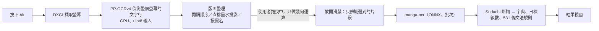

# 日文即時螢幕查字工具（jplens）

在 Windows 上**按住 Alt、用滑鼠拖曳**選取畫面上的日文（遊戲、動畫暫停畫面、漫畫、小說，橫排直排都可以），
馬上列出選到的單字：讀音、日檢級數、詞性、繁體中文意思，下面再列出句子裡的**文法句型**（例如「〜と思う」「〜かもしれない」）。
想記的字、文法、句子按「＋ 記錄」存進單字本，可以搜尋、篩選、標重點，再匯出到單字 App。

- 全部在自己的電腦上跑（文字辨識用 [manga-ocr](https://github.com/kha-white/manga-ocr)、斷詞用 Sudachi），不用網路、不用 API。
- 有 NVIDIA 顯示卡時放開滑鼠到出結果約 0.1～0.5 秒；沒有也能用（CPU，慢很多）。
- 直排小說、振假名、漫畫對話框都有特別處理。

## 下載就能用的版本

到 [Releases](../../releases) 下載壓縮檔，解壓縮後雙擊 `jplens.exe`（不用裝 Python）。右下角系統匣出現紅色「字」圖示、跳出「就緒」通知就可以用了。
Windows 10／11 64 位元。第一次開啟時 Windows SmartScreen 可能會警告（執行檔沒有簽章），按「其他資訊」→「仍要執行」。

## 怎麼用

三種選取方式（按住 Alt＋按一下右鍵、結果視窗標題列的按鈕，或系統匣選單切換）：
- **反白**：像在文書軟體裡選字，沿著文字從第一個字拖到最後一個字，只選你要的那句，跨行、直排都可以。
- **框選**：拖曳出一個矩形，查矩形裡所有的文字。
- **漫畫**：用漫畫專用的模型找出對話框裡的字，整塊讀，不會漏欄。按住 Alt **框住對話框**，或按住 Alt **雙擊對話框**。
  只適合漫畫，字幕、小說、遊戲請用另外兩種。

| 動作 | 說明 |
| --- | --- |
| 按住 Alt＋左鍵拖曳 | 選取要查的文字，放開就開始辨識 |
| 按住 Alt＋按一下右鍵 | 切換選取方式（反白 → 框選 → 漫畫） |
| 結果視窗的級數選單 | 只顯示這個級數以上的單字（級外的字一律顯示） |
| 滑鼠停在單字上 | 完整的中英文意思、出現的句子；文法顯示說明、接續、例句 |
| ＋ 記錄／＋ 記錄原句 | 存進單字本；先反白原文的一部分，就只記錄那一段 |
| 📌 | 釘選：點畫面其他地方、按 Esc 時不自動關閉（要按 ✕） |
| Esc、✕、點別的地方 | 關閉結果視窗（釘選時只有 ✕ 能關） |

**無字幕模式**（直播、沒有字幕的動畫）：按 **Alt＋L**（設定 → 查字操作可以換字母）開始，把電腦正在播的聲音即時轉成文字。
另外開一個無字幕視窗（這段時間不能框選、反白）：聽到的句子一句一句往下排，講話中先顯示灰色的暫定文字、講完換成最終結果；下面的原文框跟著正在講的那句。
點任何一句放到下面的原文框，按「🔍 查詢」才查字；往上捲看舊句子時不會被新句子打斷，按「↓ 回到最新」再跟上。
查完字可以按「▾ 收起查詢結果」把單字清單收起來。漏句、切錯時按「💾 保存聲音」存下最近 2 分鐘有聲音的部分（影片停著的時間不算），可以拿來改進。再按一次 Alt＋L 或 ✕ 結束。
開倍速看影片時，在視窗右上的播放速度選單選一樣的倍數（辨識前先放慢回原速，1.5 倍也準）。講話中按「查詢」「翻譯」會等那句講完再做；譯文留在清單那一句的下面，下一句進來也不會消失。
語音辨識只用 CPU（約單核的 5～15%）、不佔顯示卡。錄的是整台電腦的聲音（通知音、別的分頁也會錄進去）。

**系統匣選單**（「字」圖示，左鍵或右鍵；可能被收在工作列右下角的「^」裡）：
- **單字本**：單字／文法／句子分開看；搜尋、篩選（級數、詞性、記錄時間、已學會、重點單字）、排序；
  星號標**重點單字**、標記**已學會**、編輯、刪除（可以復原）。
- **匯出**：單字 → 單字 App 備份檔（重點單字會標成 App 的重點）；句子 → 編號的文字檔。匯出前可以選範圍。
- **設定**：熱鍵（Alt／Ctrl＋Shift／Ctrl＋Alt）、預設選取方式、結果視窗的字級與寬度、單字本資料夾、開機自動啟動等，改了馬上生效。
- **保存上一次查詢的畫面**：讀錯時存下來並填正確答案，當測試資料。

**遊戲裡沒反應？** 很多遊戲（例如絕區零、鳴潮）以系統管理員身分執行，Windows 不讓一般權限的程式收到在遊戲視窗上的按鍵。
從系統匣選「以系統管理員身分重新啟動」，或在設定 → 一般打開「以系統管理員身分執行」。遊戲請用視窗模式或無邊框視窗。

## 技術特點

> 測試環境：Windows 11、RTX 4060 Laptop（8 GB）、2560×1440 螢幕。

### 處理流程



### 1. 低延遲

放開滑鼠到出結果約 **0.1～0.5 秒**。

- **預先偵測**：按下 Alt 就在背景擷取並偵測整個螢幕，拖曳時只做幾何運算，放開後只辨識選到的片段。
- **DXGI 擷取**：每次擷取 2～3 ms。
- **前處理放進模型**：偵測模型改成直接吃 uint8，轉型、正規化在 GPU 上做，上傳的資料只剩四分之一。
- **辨識推論**：manga-ocr 跑在 ONNX Runtime 上，自己實作 KV cache 解碼器，用 IOBinding 讓快取留在 GPU；同一次查詢的片段批次辨識。
- **拖曳流暢**：滑鼠移動事件合併、墨水分布快取，拖曳時每次更新 0.6～2 ms。

### 2. 低記憶體

常駐記憶體約 **0.87 GB**（原本 1.58 GB），啟動約 **2 秒**（原本 11 秒）。

- **執行時不載入 PyTorch**：manga-ocr 匯出成 ONNX，自己重寫 beam search，辨識結果和原版逐字相同。
- **不靠 torch 啟用 CUDA**：自己尋找並載入 CUDA／cuDNN 程式庫，打包版直接附帶。
- **用到才載入**：漫畫模型切到漫畫模式才載入；單字本、設定視窗開啟時才建立，關掉就釋放。
- **原生介面**：PySide6 原生元件，不用內嵌瀏覽器。

### 3. 辨識準確度

- **直排小說用墨水投影找欄**：以垂直投影找出欄與振假名，再估出字格，讓選取範圍對齊字的邊界。
  框選範圍完全正確 **126 → 199**（227 個框），隨機反白 **45 → 118**（119 次）。
- **漫畫用對話框偵測模型**（RT-DETR）：整個對話框一起讀，不會漏欄。
- **振假名當讀音提示**：修正讀音，並把被斷詞拆碎的人名合成專有名詞。
- **長行重疊切段**：相鄰兩段重疊約兩個字寬，再用頭尾比對接合，避免切在字中間。
- **小字放大重新偵測**、**雙門檻偵測**（0.5 為主、0.3 補漏）。

### 4. 語言分析

- **慣用說法整組查**：連續 2～6 個詞合起來查字典（「気になる」不會拆成「気」＋「なる」），處理活用與否定。
- **讀音與詞義挑選**：依寫法、讀音、詞性挑字典條目；冷僻的意思排到後面；列出同寫法的其他常用讀音。
- **531 條文法規則**：其中 303 條由 LLM 產生，經過自動驗證（正例都要比對到、反例都不能比對到、語料命中率不能過高、不能蓋掉現有規則）與人工抽查。

### 5. 評估

- 自建評估工具：`box_eval`（用保存下來、附正確答案的實際畫面重跑計分）、`select_eval`（用全螢幕截圖模擬拖曳，比對改動前後的輸出）、合成樣本 OCR（逐字 99.6%，repo 內就能重現）。
- App 內建「保存上一次查詢的畫面」：遇到讀錯一鍵存下來、填正確答案，就變成新的測試資料。
- 文中準確度數字是用作者自己收集的真實截圖量的（遊戲、動畫、小說、漫畫，共約 120 張）；截圖有著作權，不附在 repo 裡。

### 6. Windows 系統整合

- Win32 低階滑鼠／鍵盤掛鉤、per-monitor DPI 座標換算。
- 偵測以系統管理員身分執行的遊戲並提示，可一鍵以系統管理員身分重新啟動。
- PyInstaller 打包（含 CUDA），附自我測試 `--selftest`。

## 搭配的單字 App：CharlieLearningV

查字工具記下來的單字，可以匯出到 **CharlieLearningV**（同一個作者的單字本 App）在手機上複習：搜尋、重點星號、限時測驗（選意思／選單字，可依日檢級數出題）。

- **網頁版**：<https://charlie-learning-v.netlify.app/>（不用安裝；資料存在瀏覽器裡，清除網站資料會不見，請定期在「備份」頁匯出）
- **Android**：[Releases](../../releases) 裡的 `CharlieLearningV.apk`（要允許安裝不明來源的 App）

**把單字從查字工具搬過去**：
1. 查字工具：系統匣 → 匯出 → 單字（單字 App 備份檔），存成 `.txt`。可以只匯出重點單字。
2. 把檔案傳到手機（或網頁版所在的電腦）。
3. CharlieLearningV：左側選單 →「備份」→「📥 匯入資料」，選那個檔案，確認預計結果後開始匯入。

讀音、例句（記錄時的原句）、日檢級數、重點單字都會帶過去；同一個字再匯入不會重複，只會補上空的欄位和重點標記，不會蓋掉你在 App 裡改過的內容。

## 從原始碼執行

Windows、Python 3.10。

```bash
pip install -r requirements.txt
```

repo 裡沒有模型和字典（太大），要先準備：

1. **字典** `data/dict.sqlite`：下載下面三個檔案放到 `data/raw/`，再執行 `python tools/build_dict.py`（約 1～2 分鐘）。
   - `JMdict_e.gz`：<http://ftp.edrdg.org/pub/Nihongo/JMdict_e.gz>
   - `zhwikt_ja.jsonl`：中文維基詞典的日語詞條，<https://kaikki.org/zhwiktionary/日語/>（JSONL）
   - `tomoshi/tomoshi-dict-open.db`：[Tomoshi 開放資料](https://github.com/tomoshi-app/tomoshi-dict-data/releases) 的 `.db.zst`，用 `zstd -d` 解壓縮（沒有也能建，中文意思會少很多）
2. **文字辨識模型**：`python tools/export_manga_ocr_onnx.py`，把 manga-ocr 匯出成 ONNX 到 `data/models/manga-ocr-onnx/`（約 460 MB）。
   只有匯出時需要 `pip install torch transformers manga-ocr`，之後執行查字工具不需要。
3. **漫畫模式的模型**（要用漫畫模式才需要）：[ogkalu/comic-text-and-bubble-detector](https://huggingface.co/ogkalu/comic-text-and-bubble-detector/tree/main)
   的 `detector.onnx`（NVIDIA 顯示卡用）或 `detector_int8.onnx`（CPU 用），連同 `config.json`、`preprocessor_config.json` 放到 `data/models/ogkalu/`。
4. **無字幕模式的模型**（要用無字幕模式才需要），放到 `data/models/asr/`：
   - [sherpa-onnx-zipformer-ja-reazonspeech-2024-08-01](https://github.com/k2-fsa/sherpa-onnx/releases/tag/asr-models)（`.tar.bz2`，解壓縮成同名資料夾；只用到 `*.int8.onnx` 和 `tokens.txt`）
   - [silero_vad.onnx](https://github.com/k2-fsa/sherpa-onnx/releases/tag/asr-models)（Silero v4，空檔補漏用）
   - `silero_vad_v6.onnx`：[snakers4/silero-vad v6.2.3](https://github.com/snakers4/silero-vad/tree/v6.2.3/src/silero_vad/data) 的 `silero_vad.onnx` 改名（主要的語音偵測）
5. （選用，加速）文字偵測模型改吃 uint8：`pip install onnx` 後 `python tools/export_det_onnx.py`。沒做就用 RapidOCR 附的模型。

有 NVIDIA 顯示卡時要找得到 CUDA 12＋cuDNN 9 的程式庫：放在 `data/cuda/`、pip 的 `nvidia-*` 套件，或裝了 PyTorch（cu12 版）時借用它的
（`jplens/gpu.py`）。找不到會用 CPU。

啟動：雙擊 `run_realtime_words_translate.bat`（不開主控台視窗），或要看訊息時：

```bash
python -m jplens
```

### 打包成執行檔

```bash
pip install pyinstaller
python packaging/build.py            # 帶 CUDA／cuDNN（約 3.5 GB）
python packaging/build.py --no-cuda  # 不帶（沒有 CUDA 的電腦只能用 CPU）
```

輸出在 `dist/jplens/`，整個資料夾就是可以給別人的版本；打包完會自動跑 `jplens.exe --selftest` 確認模型、字典都帶進去了。

## 檔案

| 位置 | 內容 |
| --- | --- |
| `vocab/saved_words.jsonl` | 單字本：一行一個字，含讀音、級數、中英文意思、原句、記錄時間、重點、已學會 |
| `vocab/saved_sentences.jsonl` | 記錄的原句 |
| `config.json` | 設定（設定視窗會寫入） |
| `logs/jplens.log` | 執行紀錄（每次查詢的時間、錯誤訊息） |
| `jplens/` | 程式（`app.py` 主程式、`layout.py`／`inkcols.py` 版面、`recognize.py` 辨識、`words.py` 單字與文法、`manager.py` 單字本、`settings_ui.py` 設定、`listen.py`／`listen_ui.py` 無字幕模式） |
| `tools/` | 建字典、匯出模型、文法規則與字典翻譯的批次工具 |
| `tests/` | `python -c "import tests.test_core as m; [getattr(m,k)() for k in dir(m) if k.startswith('test_')]"`（需要字典）；`tests/eval/` 是辨識準確率的評估（需要自己的截圖） |

打包版的 `config.json`、`vocab/`、`logs/` 在 `jplens.exe` 旁邊。

## 中文意思從哪裡來

依序：Gemini 翻譯（日檢單字表的詞，逐個 JMdict 意思翻譯，`dict_translate/zh.jsonl`）→ Tomoshi 開放資料 → 中文維基詞典；
都沒有才顯示 JMdict 的英文意思（標示〔英〕）。文法規則 531 條：228 條是專案原本的規則，其餘 303 條由 Gemini 依 JLPT 句型清單寫成、經自動驗證與人工抽查。

## 授權與來源

程式碼以 Apache License 2.0 授權（[LICENSE](LICENSE)）。字典等資料的授權和程式碼不同（多為 CC BY-SA 4.0），完整清單見 [NOTICE.md](NOTICE.md)。

- 英文意思、詞性：[JMdict](https://www.edrdg.org/jmdict/j_jmdict.html)（EDRDG，CC BY-SA 4.0）
- 中文意思：[Tomoshi 開放資料](https://github.com/tomoshi-app/tomoshi-dict-data)（Tomoshi (Y1Z)，CC BY-SA 4.0）、
  [中文維基詞典](https://zh.wiktionary.org/)（CC BY-SA，經 [kaikki.org](https://kaikki.org/zhwiktionary/) 擷取）、Gemini 翻譯（譯自 JMdict，CC BY-SA 4.0）
- 日檢單字表（`data/jlpt/`）：Jonathan Waller 的 JLPT 單字表（CC BY），經 open-anki-jlpt-decks（MIT）取得
- 文字辨識：[manga-ocr](https://github.com/kha-white/manga-ocr)（Apache-2.0）；文字偵測：PP-OCR／[RapidOCR](https://github.com/RapidAI/RapidOCR)（Apache-2.0）
- 漫畫模式：[ogkalu/comic-text-and-bubble-detector](https://huggingface.co/ogkalu/comic-text-and-bubble-detector)（Apache-2.0）
- 斷詞：[SudachiPy](https://github.com/WorksApplications/sudachi.rs)、SudachiDict（Apache-2.0）；介面：Qt／PySide6（LGPL-3.0）
